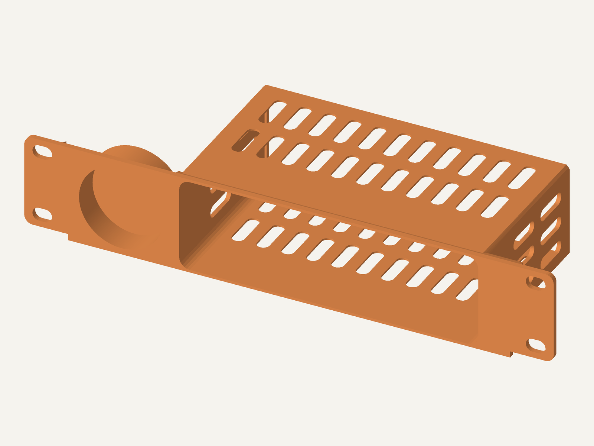
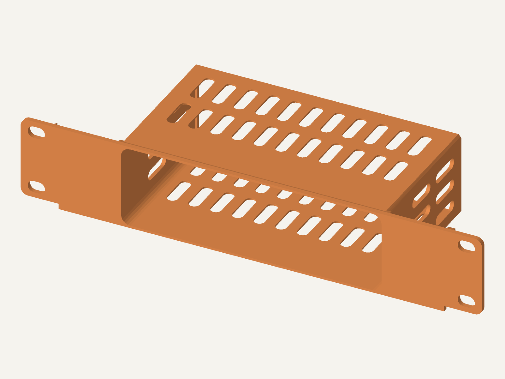
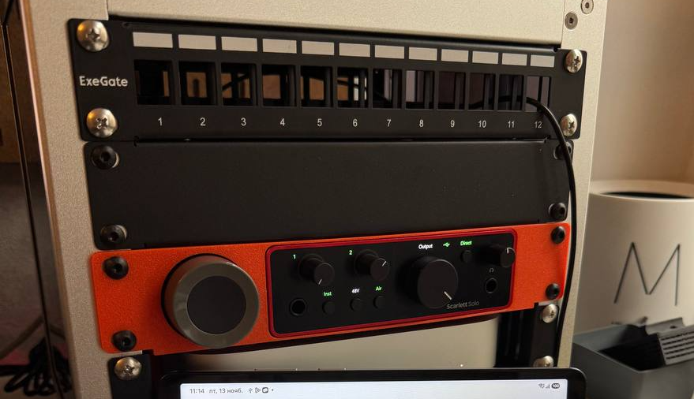
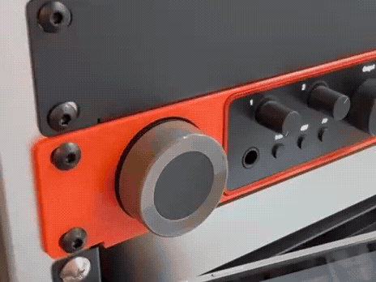

# Scarlett Solo 4th Gen — 10-inch rack mount

Three variants, all **84.2 mm deep**. Opening: **144 × 44.5 mm**. Remove the Scarlett’s rubber feet.

[View on MakerWorld](https://makerworld.com/en/models/3630615-scarlett-solo-4th-gen-10-inch-rack-mount)

[Downloads](https://github.com/aotd1/focusrite-scarlett-solo-rack/releases/latest)

## Variants — 3D views

| Knob cup | Centered / solid | Centered / front vents |
|---|---|---|
|  |  |  |
| Scarlett right, knob left. | Scarlett and sleeve centered on the panel, with solid front wings. | Centered, with three 6 × 26 mm front slots per side. |
| [3MF](models/knob-cup/knob-cup.3mf) | [3MF](models/centered-solid/centered-solid.3mf) | [3MF](models/centered-front-vents/centered-front-vents.3mf) |

## Knob-cup variant in use

**Tuya Smart Knob ERS-10TZBVK-AA**. Cup: Ø40.8 × 13 mm. Rear magnet recess: Ø6 × 2 mm, behind a 0.4 mm membrane.

[Watch/download the MP4](assets/knob/knob-demo.mp4)

## Printing and installation

[P1S / PETG print profiles — all three variants](profiles/p1s/README.md)

Front face on the bed, rotated 45°. Starting settings: PETG, 0.4 mm nozzle, 0.2 mm layers, two walls, 20% gyroid, five top/bottom layers. **Support the closed cup floor from the build plate.** The 3MFs contain placed geometry for slicing.

Overall size: **255.05 × 84.2 × 47.1 mm**. The central 213 mm lip extends 3.1 mm below the original 1U outline; leave clearance underneath. All variants retain the four rack slots and 56 sleeve ventilation slots.

[Build from source](docs/BUILD.md)

## Source and license

[Source on GitHub](https://github.com/aotd1/focusrite-scarlett-solo-rack)

Remix of [Jonathan Lemoine’s Scarlett Solo 3rd Gen rack mount](https://www.printables.com/model/1565705-focusrite-scarlettsolo-3rd-gen-10-inch-rack-mount). **[CC BY-NC 4.0](LICENSE.md)** · [Attribution and changes](ATTRIBUTION.md).
