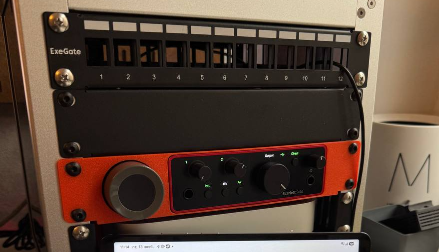
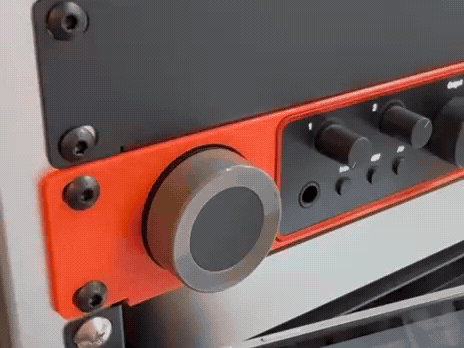

# Scarlett Solo 4th Gen — 10-inch Rack Mount

Three variants with the original **84.2 mm depth**. Opening: **144 × 44.5 mm** — remove the Scarlett’s rubber feet.

**Version 1.0.0**

## Choose a variant

| Variant | Layout |
|---|---|
| Knob cup | Scarlett right, Tuya Smart Knob ERS-10TZBVK-AA left. |
| Centered / solid | Scarlett and sleeve centered on the panel, with solid front wings. |
| Centered / front vents | Centered, with three rounded 6 × 26 mm front slots per side. |

All variants measure **255.05 × 84.2 × 47.1 mm** and retain the four rack slots and 56 sleeve ventilation slots. The central 213 mm lip extends **3.1 mm below the original 1U outline**; leave clearance underneath.

## Knob-cup variant

For **Tuya Smart Knob ERS-10TZBVK-AA**. Internal cup: **Ø40.8 × 13 mm**, with 2 mm walls and a 2.4 mm closed floor. The rear **Ø6 × 2 mm** magnet recess leaves a **0.4 mm membrane** toward the knob, with no added magnet-fit allowance.

## Printing

Print front-face down, rotated 45°. Suggested starting settings: **PETG, 0.4 mm nozzle, 0.2 mm layers, two walls, 20% gyroid, five top/bottom layers**. Use temperatures suited to your filament. **Add build-plate supports inside the cup under its closed floor.**

The 3MFs contain placed geometry for slicing. The print envelope is approximately **208.15 × 208.15 × 84.2 mm**; allow additional space for supports or a brim.

## Remix and source

Remixed from [Jonathan Lemoine’s Focusrite Scarlett Solo 3rd Gen 10 inch rack mount](https://www.printables.com/model/1565705-focusrite-scarlettsolo-3rd-gen-10-inch-rack-mount). Changes: feet-off 4th Gen opening, central lower lip, sleeve ventilation, knob cup with magnet recess, and centered options.

**CC BY-NC 4.0** — https://creativecommons.org/licenses/by-nc/4.0/

[Source, parameters and releases](https://github.com/aotd1/focusrite-scarlett-solo-rack)
